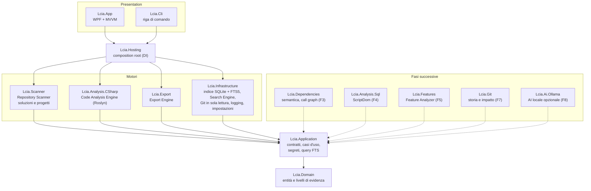
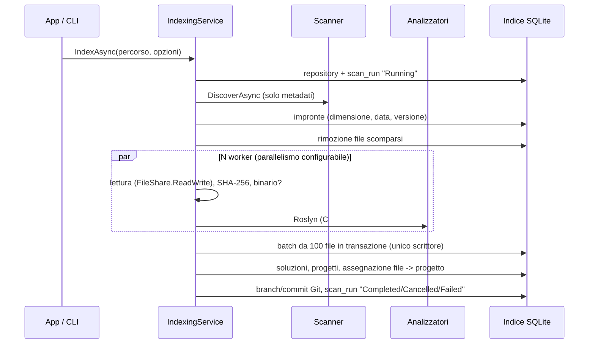

# Architettura

Documento di riferimento per la struttura di Local Code Intelligence Analyzer (LCIA). Descrive lo stato della
versione 0.2.0 (Fasi 1–2) e l'evoluzione prevista per le fasi successive.

## Principi

1. **Accuratezza e tracciabilità prima di tutto.** Ogni simbolo e ogni relazione hanno file, riga e livello di
   evidenza. Una relazione non risolta semanticamente non viene mai presentata come "verificata".
2. **Locale e in sola lettura.** Nessun upload, nessuna esecuzione del codice analizzato o di script SQL, nessuna
   scrittura nei repository analizzati (verificato da test automatici con confronto degli hash).
3. **Motore deterministico indipendente dall'AI.** Scansione, analisi, ricerca ed esportazione funzionano senza
   alcun modello; l'AI (Fase 8) potrà solo interpretare richieste e spiegare risultati già provati.
4. **Modularità.** Ogni motore è un progetto con un'interfaccia nel livello Application; l'applicazione desktop,
   la CLI e i test usano la stessa composizione (dependency injection).

## Diagramma dei moduli e delle dipendenze



Regole di dipendenza: `Domain` non dipende da nulla; `Application` dipende solo da `Domain` (e dalle astrazioni di
logging); i motori dipendono da `Application`; solo `Hosting`, `App`, `Cli` e i test conoscono le implementazioni.

## Corrispondenza con i moduli richiesti

| Modulo | Dove | Stato |
|---|---|---|
| Presentation Layer | `Lcia.App` (WPF), `Lcia.Cli` | Fase 2 |
| Application Layer | `Lcia.Application` (interfacce, `IndexingService`, `FtsQueryBuilder`, `RegexSecretScanner`) | Fase 2 |
| Domain Layer | `Lcia.Domain` | Fase 2 |
| Infrastructure Layer | `Lcia.Infrastructure` | Fase 2 |
| Repository Scanner | `Lcia.Scanner` (`FileSystemRepositoryScanner`, `WorkspaceDiscovery`) | Fase 2 |
| Code Analysis Engine | `Lcia.Analysis.CSharp` (`CSharpSyntaxAnalyzer`) | Sintassi F2, semantica F3 |
| Dependency Analysis Engine | relazioni sintattiche in F2; `Lcia.Dependencies` | F3 |
| SQL Analysis Engine | `Lcia.Analysis.Sql` | F4 |
| Search Engine | `Lcia.Infrastructure/Search` (`SqliteSearchService`) | Fase 2 |
| Feature Analysis Engine | `Lcia.Features` | F5 |
| Git Integration | `GitHeadReader` (branch/commit) in F2; `Lcia.Git` | F7 |
| Export Engine | `Lcia.Export` | TXT/MD F2, JSON e modalità F6 |
| AI Integration Layer | `Lcia.Ai.Ollama` | F8 |
| Logging e Diagnostics | `FileLoggerProvider`, `InMemoryLogSink` (con oscuramento) | Fase 2 |

## Struttura della solution

```
LocalCodeIntelligenceAnalyzer.slnx
Directory.Build.props        versione, nullable, impostazioni comuni
Directory.Packages.props     versioni NuGet centralizzate
global.json                  .NET SDK 10
src/
  Lcia.Domain/               entità: RepositoryInfo, IndexedFile, CodeSymbol, SymbolRelation, ProjectInfo, ...
  Lcia.Application/          contratti dei motori, IndexingService, ricerca, export, sicurezza, testo, percorsi
  Lcia.Infrastructure/       SQLite (schema, store, ricerca), lettura file, Git, logging, impostazioni
  Lcia.Scanner/              scansione file system, lettura .sln/.slnx/.csproj
  Lcia.Analysis.CSharp/      Roslyn
  Lcia.Export/               dossier TXT/Markdown, suddivisione in parti
  Lcia.Hosting/              AddLocalCodeIntelligence(): registrazione dei servizi
  Lcia.Cli/                  lcia.exe
  Lcia.App/                  LocalCodeIntelligenceAnalyzer.exe (WPF)
tests/
  Lcia.Tests/                xUnit: unità + integrazione su samples/DemoShop
  scripts/                   Pester: script di pubblicazione
samples/DemoShop/            progetto dimostrativo (controller, service, repository, DI, SQL)
scripts/                     build, publish, Git/GitHub
docs/                        documentazione
```

## Flusso di indicizzazione



### Strategia di indicizzazione

- **Scoperta**: visita iterativa (nessuna ricorsione sullo stack), esclusioni per nome e per percorso, limite di
  profondità, link simbolici/junction ignorati per impostazione predefinita e comunque mai seguiti fuori dalla radice.
- **Incrementale**: un file è rielaborato solo se cambiano dimensione o data di modifica, o se cambia
  `IndexFormat.Version` (analizzatori migliorati). Se la data cambia ma lo SHA-256 no, si aggiornano solo i metadati.
- **Parallelismo controllato**: `Parallel.ForEachAsync` con grado configurabile → canale limitato →
  un solo consumatore che scrive in transazioni da 100 file (SQLite ha un solo scrittore).
- **Annullamento e ripresa**: i batch già scritti restano validi; l'esecuzione viene registrata come annullata e la
  successiva salta i file invariati. All'avvio le esecuzioni rimaste "in corso" vengono marcate come interrotte.
- **Full-text**: il testo è diviso in blocchi da 40 righe (tabella `chunks`) indicizzati in FTS5 con due colonne:
  `content` e `idents` (identificatori spezzati: `CreateOrderAsync` → `create order async`). La riga esatta di ogni
  risultato si ottiene cercando i termini dentro il blocco.
- **Limiti**: file oltre la dimensione massima (predefinita 2 MB) o binari restano elencati con il loro stato ma non
  sono indicizzati né esportati.

## Livelli di evidenza delle relazioni

| Livello | Significato | Prodotto da |
|---|---|---|
| `DirectVerified` | Diretta e verificata (simbolo risolto) | Fase 3 (modello semantico) |
| `IndirectVerified` | Indiretta ma verificata (catena di relazioni verificate) | Fase 3+ |
| `TextualReference` | Corrispondenza di nome senza risoluzione | Invocazioni, `new` (F2) |
| `InferredWithEvidence` | Dichiarazione presente, nome non risolto | Tipi base, costruttori, campi, DI (F2) |
| `Dynamic` | Determinata a runtime (factory, reflection, SQL dinamico) | DI con factory (F2), SQL dinamico (F4) |

## Livelli di supporto per linguaggio

| Linguaggio / formato | Livello in 0.2.0 | Note |
|---|---|---|
| C# | Sintattico | Roslyn; semantico in Fase 3 |
| `.sln`, `.slnx` | Strutturale | Elenco progetti, progetti esterni segnalati |
| `.csproj`, `.vbproj`, `.fsproj`, `.sqlproj`, `.props`, `.targets` | Strutturale (progetti) / testo | Framework, riferimenti, NuGet (CPM, `packages.config`) |
| T-SQL | Testo | ScriptDom in Fase 4 |
| VB.NET, F# | Testo | Roslyn VB pianificato |
| JSON, XML, `.config`, YAML | Testo + rilevamento segreti | |
| Razor, XAML | Testo | |
| JavaScript, TypeScript, Python, Java, Go, PHP | Testo | Tree-sitter pianificato (Fase 9) |
| Markdown | Testo | |

"Testo" significa: indicizzazione full-text, ricerca per parole/testo/regex con riga, inclusione nell'export.

## Schema del database locale

Dettagli e migrazioni: [DATABASE_SCHEMA.md](DATABASE_SCHEMA.md). Tabelle principali: `repositories`, `scan_runs`,
`projects`, `project_references`, `files`, `symbols`, `relations`, `chunks`, `content_fts` (FTS5).
La versione dello schema è in `PRAGMA user_version`; le migrazioni sono applicate in transazione all'avvio.

## Esportazione (Full Project Context Export)

- Il contenuto viene riletto dal disco al momento dell'esportazione (sempre aggiornato); se l'hash differisce da
  quello indicizzato il file è segnalato come "modificato dopo l'indicizzazione".
- Ordine del dossier: intestazione con istruzioni per l'AI → albero → elenco file → soluzioni e progetti → indice
  dei tipi → riferimenti incrociati → blocchi file (`FILE:` … `SOURCE CODE:` … `END OF FILE:`) → riepilogo e limiti.
- Scrittura in streaming; un file non viene spezzato tra due parti salvo che da solo superi il limite. Con più parti
  viene creato `<nome>.index.<ext>` con l'elenco delle parti e dei file contenuti.
- La cartella di destinazione deve essere esterna al repository; i file esistenti non vengono mai sovrascritti.

## Interfaccia (Lcia.App)

- **MVVM** con CommunityToolkit.Mvvm; ogni pagina è un `PageViewModel` mostrato tramite `DataTemplate`.
  Pagine: Dashboard, Esplora, Cerca, Esporta, Log, Impostazioni, Guida; scorciatoie da tastiera in `MainWindow`.
- **Tema** (`ThemeService`): chiaro, scuro o come Windows, applicato senza riavvio. I controlli standard usano il
  tema Fluent di WPF (`Application.ThemeMode`, con ripiego sui dizionari `Fluent.Light/Dark.xaml`); gli elementi
  dell'applicazione usano le palette `Resources/Theme.Light.xaml` e `Theme.Dark.xaml` (stesse chiavi `Lcia.*`,
  riferite con `DynamicResource`). La barra del titolo e i colori della sintassi di AvalonEdit seguono il tema.
- **Guida in linea** (`HelpViewModel`, `HelpView`): `docs/USER_GUIDE.md` è incorporato nell'eseguibile, diviso in
  argomenti dal parser `MarkdownLite` (in `Lcia.Application`, testato) e mostrato come `FlowDocument`.
  Una sola fonte per manuale e documentazione; nessun accesso alla rete.

## Sicurezza

| Rischio | Contromisura |
|---|---|
| Fuga di segreti nei dossier | `RegexSecretScanner` (token noti, chiavi PEM, connection string, chiavi di configurazione, segreti nel codice); esclusione di `secrets.json`, `.env`, chiavi; conferma esplicita per disattivare |
| Segreti nei log | Ogni riga di log passa dallo stesso filtro; nessun contenuto dei file viene registrato |
| Path traversal | `PathUtilities.ResolveInside` su ogni accesso a file da percorso relativo; link esterni ignorati |
| Modifica dei repository | Apertura dei file in sola lettura con condivisione; export solo in cartelle esterne; test con confronto hash |
| XML ostile nei progetti | `DtdProcessing.Prohibit`, nessun resolver, limite di dimensione |
| Regex lente | Timeout su ogni espressione (segreti 250 ms, ricerca utente 1 s per riga) |
| Pubblicazione accidentale | Script 03 blocca build output, database, log, chiavi, file grandi e segreti; nessun token negli script |

## Strategia di test

- **Unità** (xUnit): testo e codifiche, identificatori, query FTS, percorsi, segreti, analizzatore C#, scanner,
  soluzioni/progetti, Git.
- **Integrazione** su una copia di `samples/DemoShop`: indicizzazione completa e incrementale, annullamento e ripresa,
  limiti di dimensione e file binari, ricerca in tutte le modalità con filtri combinati, export TXT/Markdown,
  suddivisione in parti, oscuramento dei segreti, rifiuto di destinazioni interne, invarianza del repository.
- **End-to-end CLI** (`scripts\build.ps1`): index → search → refs → export con verifiche sul dossier.
- **Script** (Pester): parsing di `git status`, blocco file vietati e segreti, allowlist, conferme.
- **CI** (GitHub Actions, `windows-latest`): build, test, prova CLI, Pester a ogni push e pull request.
- Previsti: test della UI (FlaUI) e test di prestazioni su repository grandi (Fase 9).

## Rischi e limiti tecnici

- **Analisi solo sintattica (F2)**: i nomi nelle relazioni non sono risolti; omonimi in namespace diversi non sono
  distinti. La Fase 3 introduce `MSBuildWorkspace` (richiede SDK/Visual Studio installati sul PC che analizza).
- **Progetti che non compilano**: l'analisi sintattica funziona comunque; in Fase 3 la semantica sarà parziale e
  dichiarata come tale per i progetti non caricabili.
- **Preprocessore**: il codice sotto `#if` non attivo non viene analizzato (resta cercabile come testo).
- **SQL dinamico e reflection**: non sempre determinabili; saranno marcati `Dynamic`.
- **Dimensione dell'indice**: il testo dei file è memorizzato in FTS5 (circa 1,5–3 volte la dimensione dei sorgenti
  indicizzati).
- **Rilevamento dei segreti**: euristico; può oscurare valori innocui (scelta conservativa) e non garantisce di
  trovare formati sconosciuti. Ogni oscuramento è elencato nel dossier.
- **Stima dei token**: circa 4 caratteri per token; il valore reale dipende dal modello.
- **Tema Fluent**: dipende dal tema Fluent di WPF per .NET 9+ (`ThemeMode` è ancora marcata sperimentale,
  avviso WPF0001); se non disponibile viene usato il tema classico, solo chiaro (impostazione disattivabile).
- **Verifica**: la versione 0.2.0 è stata scritta senza poterla compilare nell'ambiente di sviluppo usato; la prima
  build con test e prova della CLI (`scripts\build.ps1`) è poi riuscita su Windows 11. Avvio della GUI e test
  Pester da confermare (vedi ROADMAP).
